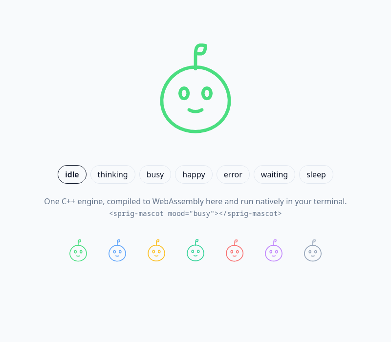

# sprig

A small sprout that shows what your coding agent is doing. It thinks while you
type, gets busy during tool calls, cheers when a turn finishes, droops when
something fails, and falls asleep when you leave.

One C++ engine runs everywhere: natively in your terminal, and as a 10 KB
WebAssembly module in the browser. It works with Claude Code, Codex, pi, or
anything that can run a shell command.



## Install

**Terminal and agent users** (no Node needed):

```sh
curl -fsSL https://raw.githubusercontent.com/AkhileshThykkat/sprig/main/install.sh | sh
```

It installs the `sprig` binary (checksum-verified), then finds Claude Code,
Codex and pi on your machine and offers to connect each one. It asks you to
choose between:

- **its own folder** (default): everything lives in `~/.sprig` and is
  symlinked into place, so removing it is one step;
- **copy**: files go straight into `~/.local/bin` and your agents' folders.

Options go after `sh -s --`: `--yes` (take the defaults), `--link`, `--copy`,
`--agents-only`, `--uninstall`.

**With npm** (also gets you the web component):

```sh
npm i -g sprig-mascot
sprig setup        # connect Claude Code, Codex and pi
```

**One agent at a time:**

| Agent | Command |
|---|---|
| Claude Code | `/plugin install sprig --marketplace AkhileshThykkat/sprig` |
| Codex | `codex plugin marketplace add AkhileshThykkat/sprig && codex plugin add sprig@sprig` |
| pi | `pi install npm:sprig-mascot` |
| Anything else | `sprig emit busy` (or any mood below) |

Plugins need the `sprig` command on your PATH. Hooks call `sprig hook`, which
always exits 0 and prints nothing, so it can never block or change what your
agent does. With no viewer running, every command returns at once.

**From source:** needs a C++20 compiler; the web module also needs `clang`
and `wasm-ld` (from `lld`), but a built `web/sprig.wasm` is checked in.

```sh
make && make test && make install
```

## Use it

Open a small terminal split and run:

```sh
sprig           # q or Ctrl-C quits
sprig demo      # cycle through every mood
```

Prebuilt binaries cover Linux (x86_64, arm64) and macOS (universal). On
Windows, use WSL.

| Mood | When | Look |
|---|---|---|
| `idle` | session start | calm, slow sway |
| `thinking` | prompt sent, between tools | eyes up and to the side |
| `busy` | a tool is running | bouncing, eyes darting |
| `happy` | turn finished | squint, big smile, hops; back to idle after 2.5 s |
| `error` | a tool failed | frown, drooping leaf, shiver; back to idle after 4 s |
| `waiting` | needs your input or permission | wide eyes, leaf perked |
| `sleep` | session ended, or idle for 3 minutes | eyes shut, slow breathing |

## On the web

```html
<script type="module" src="web/sprig.js"></script>
<sprig-mascot mood="busy"></sprig-mascot>
```

Set `mood` from your page's code. Size it with CSS (96 px by default). The
`color` attribute overrides the mood colours. It pauses when off-screen and
respects `prefers-reduced-motion`. `web/index.html` is a demo: serve the
folder (`python3 -m http.server -d web`) and open it.

## How it is built

- `core/sprig.hpp` is the entire engine: springs, moods, blinking, geometry.
  It is freestanding C++20, with no heap, no exceptions and no standard
  library, and every buffer is fixed-size and bounds-checked. It runs at
  compile time too (`static_assert`s at the bottom).
- `app/sprig.cpp` is the terminal viewer. It draws braille dots at 30 fps and
  only writes when the picture changes. It uses RAII for every file
  descriptor and restores the terminal state on any exit. Events arrive
  through a per-user named pipe in `$XDG_RUNTIME_DIR`.
- `core/sprig_wasm.cpp` exports the same engine to JavaScript. The module
  imports nothing, and its stack sits below its data, so an overflow traps
  instead of corrupting memory.

The idea came from [aster-mascot](https://aster-mascot.vercel.app); the
design and code here are original.

## License

MIT
